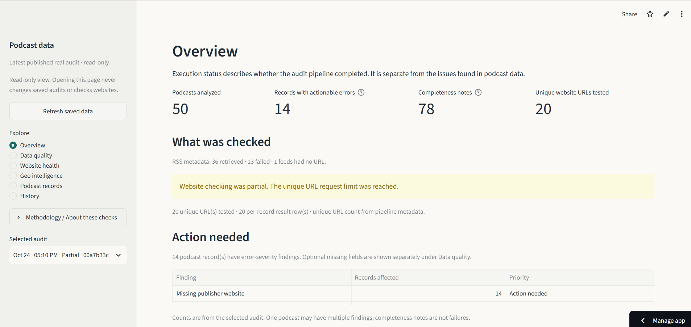
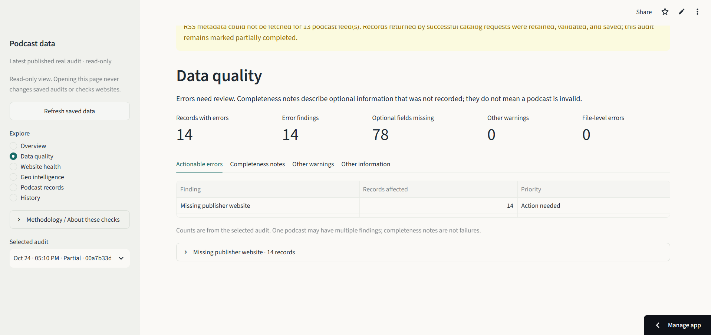
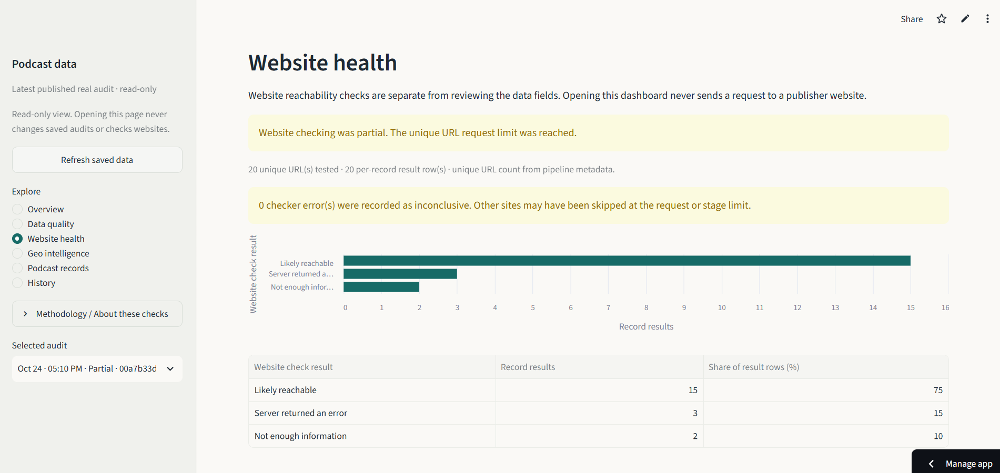

# Podcast Data Quality & Analytics Pipeline

- Live dashboard: [podcast-data-quality-pipeline.streamlit.app](https://podcast-data-quality-pipeline.streamlit.app/)
- Python CI: [GitHub Actions workflow](https://github.com/ItszVT/podcast-data-quality-pipeline/actions/workflows/python-tests.yml)

## Overview

This project checks the quality and availability of podcast catalog data. It collects podcast listings from Apple Podcasts, reads publisher RSS feeds, validates metadata, checks a bounded set of publisher websites, and keeps each audit for comparison over time.

The Streamlit dashboard presents saved audit results. It separates pipeline status from data findings, shows which website checks ran, and provides geographic information only when source evidence supports it.

## How it works

The scheduled GitHub Actions workflow runs the daily collection and publishes a validated SQLite snapshot. Each run restores the previous database and appends a new audit, preserving earlier observations.

The collection plan targets up to 50 unique Apple podcast IDs: 35 repeats for comparisons over time and 15 exploration records selected across documented topic, language-query, and storefront groups. The allocation is configurable, and the run report records achieved counts and shortfalls. Apple storefront is collection context; it does not establish publisher location or podcast origin.

For each record, the pipeline requests RSS metadata sequentially. Responses are limited to 4,000,000 bytes and must be completely retrieved and parse as valid XML. Missing fields remain missing, and retrieval failures are recorded as incomplete collection evidence.

Publisher website checks use a separate, bounded stage. The checker validates DNS answers, pins requests to approved public IP addresses, verifies the original hostname and TLS certificate, and revalidates each redirect. It does not inherit proxy settings or follow redirects automatically. HTTP failures and possible soft-404 pages are reported as separate outcomes. The daily workflow enables website checks; local collection leaves them off unless `--check-websites` is supplied.

## Architecture

1. GitHub Actions collects podcast listings, retrieves RSS metadata, validates records, and appends an audit to SQLite.
2. The workflow checks database integrity and publishes the SQLite snapshot to the `audit-snapshots` branch.
3. Streamlit Community Cloud reads the private snapshot through GitHub's Contents API with a read-only token.
4. Local CSV and XLSX files can also be ingested into SQLite for analysis with SQL and the local dashboard.

The dashboard reads SQLite in read-only mode. It does not run collection or website requests. Publication runs are serialized, restore the previous snapshot, and publish only the validated SQLite file. A partial RSS audit may be published only when collection thresholds, validation, persistence, and SQLite integrity checks pass.

## Dashboard preview

The dashboard shows the selected audit's status and findings, with detailed records available in separate sections.

**Overview** — audit status, execution details, and items that need attention.



**Data quality** — actionable errors separated from notes about missing optional fields.



**Website health** — saved website observations and their classifications for the selected audit.



## Tech stack

- Python 3.11 for collection, validation, URL checks, and pipeline orchestration
- SQLite for append-only audit history and published snapshots
- SQL for run-scoped quality measures, website outcomes, and historical comparisons
- Streamlit for the read-only dashboard
- GitHub Actions for scheduled collection, snapshot publication, and Python regression tests

PostgreSQL support is groundwork only: optional connection configuration, TLS checks, migrations, and test scaffolding exist. The production pipeline, persistence layer, and dashboard use SQLite; PostgreSQL audit persistence and dashboard support are not implemented.

## Results and limits

In one controlled GitHub Actions verification, the pipeline recovered 35 of 35 repeat IDs through Apple Lookup and collected 15 of 15 exploration IDs through Apple Search. It persisted 50 unique records. RSS parsing succeeded for 42 records; six responses exceeded the 4 MB limit, one request timed out, and one record had no feed URL. The audit was marked partial, while validation, persistence, and SQLite integrity checks succeeded. These figures describe that run only.

A separate paired experiment applied 2 MB and 4 MB limits to the same 50 IDs and resolved feed URLs. Complete RSS parses increased from 36 to 42, with no successful parse at 2 MB failing at 4 MB. Sampled peak process memory was 68.03 MiB and 70.7 MiB, respectively. These measurements apply to the experimental sample, not every audit.

Apple search results depend on query terms and storefront. RSS availability and publisher metadata are controlled by publishers. The collection is not globally representative, and the project does not infer country of origin from language, domain, category, or storefront. Synthetic fixtures are used for tests only and are not added to production audit history.

A partial audit means some collection evidence is missing; it does not by itself mean that saved records were discarded or that persistence failed. Missing RSS data can reflect an absent feed URL, an unavailable feed, or incomplete metadata. Older audits may not distinguish all of these cases. Website outcomes apply only to URLs actually checked.

## Running locally

Python 3.11 or newer is recommended. From PowerShell:

```powershell
py -3 -m venv .venv
.\.venv\Scripts\Activate.ps1
python -m pip install --upgrade pip
pip install -r requirements.txt
```

Run the tests:

```powershell
python -m pytest -q
```

Run an offline CSV audit using the included sample data:

```powershell
python -m src.audit_runner --input data/sample_podcasts.csv --database data/podcast_audits.sqlite
```

Run live Apple and RSS collection:

```powershell
python -m src.daily_pipeline --database data/real_podcast_audits.sqlite
```

Website checks are opt-in locally. Add `--check-websites` to the command to run them. Checks are limited to 20 unique URLs and a 90-second stage budget. The scheduled GitHub Actions workflow enables them explicitly. See [daily pipeline options and status semantics](docs/daily-pipeline.md) before running live collection.

Start the dashboard with:

```powershell
streamlit run app.py
```

The local dashboard reads an existing SQLite database without writing to it. Published mode reads the latest snapshot from the private `audit-snapshots` branch; configuration is described in [cloud deployment](docs/cloud-mvp-deployment.md).

## SQL analysis and documentation

The [`sql/`](sql/) directory contains queries for row counts, validation issues and rates, website outcomes and HTTP statuses, redirects, missing website URLs, duplicate feed IDs, and audit-to-audit comparisons. [The SQL analysis guide](docs/sql-analytics-evaluation.md) explains measures, denominators, and interpretation limits.

Further documentation:

- [Dashboard sections and metric definitions](docs/dashboard.md)
- [Daily pipeline options and status semantics](docs/daily-pipeline.md)
- [Real collection provenance and safeguards](docs/real-dataset-collection.md)
- [SQLite schema and append-only history](docs/sqlite-persistence.md)
- [PostgreSQL groundwork and limitations](docs/postgres-foundation.md)
- [Cloud deployment and snapshot operation](docs/cloud-mvp-deployment.md)
- [Website checker security and classifications](docs/url-checker.md)

The sample CSV and controlled reference cases are synthetic test fixtures. Real collected metadata is kept separate; review source terms and attribution requirements before redistributing it. Tests use temporary databases, mocked API calls, and local fixtures rather than contacting public sites or Neon. Credentials should not be stored in source control, SQLite snapshots, or workflow logs.
